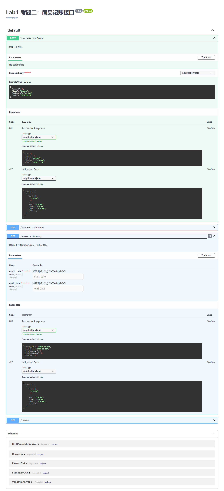
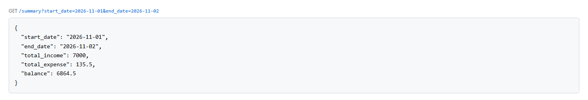
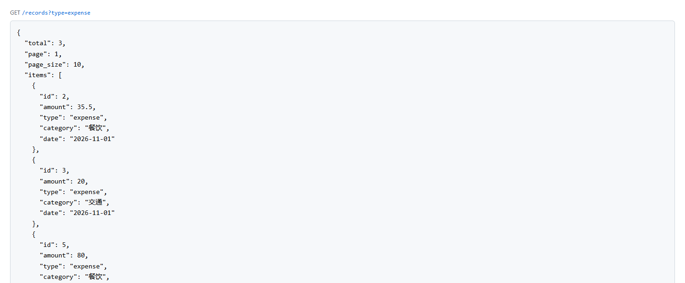
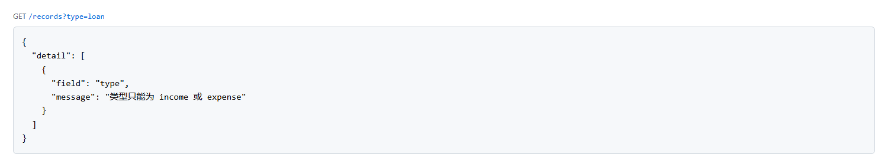

# 实验报告：Lab1 考题二 · FastAPI 简易记账接口

| 项目 | 内容 |
| --- | --- |
| 课程 | Python 程序设计 |
| 实验名称 | Lab1 考题二：FastAPI 简易记账接口（Python Vibe Coding 实验一） |
| 姓名 / 学号 | ________ / ________ |
| 完成日期 | 2026-11-18 |
| 仓库地址 | https://github.com/qls-eng/fastapi-expense-tracker-lab1 |

## 一、实验目的

1. 掌握 FastAPI 的基本用法：路由声明、请求体 / 查询参数、响应模型、自动生成 OpenAPI 文档。
2. 掌握用 pydantic 做入参校验，并把校验失败统一成结构化的 4xx 响应。
3. 掌握 pytest + TestClient 的接口测试方法，覆盖正常流程与边界 / 异常输入。
4. 体会"接口可自解释"：让 Swagger 页面本身成为可交付的接口说明书。

## 二、需求分析

一个最小可用的记账服务，需要三件事：**记一笔、查明细、看汇总**。

| 接口 | 方法 | 作用 | 关键约束 |
| --- | --- | --- | --- |
| `/records` | POST | 新增一条流水，返回 201 与完整字段 | 金额 > 0；类型 ∈ {income, expense}；分类非空；日期为合法 `YYYY-MM-DD` |
| `/records` | GET | 按类型 / 分类 / 日期区间筛选并分页 | `page ≥ 1`；`1 ≤ page_size ≤ 100`；非法 type 取值返回 422 |
| `/summary` | GET | 返回区间内收入合计、支出合计、结余 | 起止日期必填；空区间返回三项 0，不报错 |
| `/` | GET | 健康检查 | 用于确认服务已启动 |

错误响应统一为：

```json
{"detail": [{"field": "amount", "message": "..."}]}
```

## 三、技术选型与环境

| 项 | 选择 | 说明 |
| --- | --- | --- |
| Web 框架 | FastAPI 0.162.0 | 自带 OpenAPI 文档，类型注解直接生成校验 |
| 数据模型 | pydantic v2 | 请求体校验、响应模型序列化 |
| 服务器 | uvicorn | 本地 `127.0.0.1:8000` |
| 测试 | pytest 9.2.0 + `fastapi.testclient` | 进程内调用，不用真起服务 |
| 运行环境 | Windows 11 + Python 3.13.18（项目内 `.venv`） | 依赖全部装在虚拟环境，不污染全局 |

## 四、核心实现

### 4.1 应用工厂

`src/main.py` 用 `create_app(store=None)` 创建应用，测试时注入独立的 `RecordStore`，保证用例之间数据不串：

```python
def create_app(store: Optional[RecordStore] = None) -> FastAPI:
    app = FastAPI(title="Lab1 考题二：简易记账接口", version="1.0.0")
    app.state.store = store or RecordStore()
    ...
```

### 4.2 入参校验

- 请求体由 `RecordIn`（pydantic）约束：`amount > 0`、`type` 用 `Literal["income", "expense"]`、`category` 去空格后非空、`date` 用 `date` 类型自动解析。
- 查询参数由 `Query(ge=1)` / `le=100` 约束分页；`/records` 的 `type` 额外做一次取值判断，非法即时抛 422。
- 校验错误统一由 `RequestValidationError` 处理器整理成 `{"field", "message"}` 列表，字段名去掉 `body.` / `query.` 前缀，前端可直接定位到具体字段。

### 4.3 存储与并发

`src/store.py` 用内存列表 + 一把 `threading.Lock`：

- 写入时在锁内分配自增 ID 并追加，保证 ID 不重复；
- 查询时先复制快照再过滤，避免遍历期间列表被并发修改；
- 服务重启数据清空——这是考题范围内的合理取舍，报告第五节会说明后续如何替换为 SQLite。

## 五、测试与验证

### 5.1 自动化测试

在项目根目录执行：

```bash
.venv\Scripts\python.exe -m pytest tests -v
```

实测结果（2026-11-18）：

```text
tests/test_api.py::test_add_records_success PASSED
tests/test_api.py::test_amount_must_be_positive PASSED
tests/test_api.py::test_invalid_type_rejected PASSED
tests/test_api.py::test_invalid_date_format_rejected PASSED
tests/test_api.py::test_empty_category_rejected PASSED
tests/test_api.py::test_list_filter_by_type_and_category PASSED
tests/test_api.py::test_list_filter_by_date_range PASSED
tests/test_api.py::test_list_pagination PASSED
tests/test_api.py::test_invalid_pagination_rejected PASSED
tests/test_api.py::test_invalid_query_type_rejected PASSED
tests/test_api.py::test_summary_calculation PASSED
tests/test_api.py::test_summary_empty_range_returns_zero PASSED
tests/test_api.py::test_summary_missing_date_rejected PASSED
======================== 13 passed, 1 warning in 2.38s ========================
```

唯一 warning 是 `StarletteDeprecationWarning: Using httpx with starlette.testclient is deprecated; install httpx2 instead.`，属于框架升级提示，不影响用例结果（详见第七节）。

完整输出另存于 `docs/images/pytest_output.txt`。

### 5.2 真实启动后的接口调用

启动 `uvicorn src.main:app --host 127.0.0.1 --port 8000`，向接口写入 5 条流水：

| id | 金额 | 类型 | 分类 | 日期 |
| --- | --- | --- | --- | --- |
| 1 | 5000.0 | income | 工资 | 2026-11-01 |
| 2 | 35.5 | expense | 餐饮 | 2026-11-01 |
| 3 | 20.0 | expense | 交通 | 2026-11-01 |
| 4 | 2000.0 | income | 兼职 | 2026-11-02 |
| 5 | 80.0 | expense | 餐饮 | 2026-11-02 |

随后调用汇总与筛选接口，手算核对：

| 核对项 | 手算 | 接口返回 | 结论 |
| --- | --- | --- | --- |
| 收入合计 | 5000 + 2000 = 7000 | `total_income: 7000` | 一致 |
| 支出合计 | 35.5 + 20 + 80 = 135.5 | `total_expense: 135.5` | 一致 |
| 结余 | 7000 − 135.5 = 6864.5 | `balance: 6864.5` | 一致 |
| type=expense 明细 | 3 条（id 2/3/5） | `total: 3` | 一致 |
| type=loan 非法取值 | 应 422 | HTTP 422 | 符合预期 |

### 5.3 接口文档截图

Swagger 自动文档（`http://127.0.0.1:8000/docs`，已展开 POST /records 与 GET /summary）：



区间汇总的真实响应（截图取自浏览器访问该 URL 时返回的内容，JSON 已格式化显示）：



按支出筛选的真实响应：



非法类型取值的 422 响应：



## 六、问题与解决

| 问题 | 现象 | 处理 |
| --- | --- | --- |
| 校验错误格式不统一 | 默认 422 响应是 FastAPI 原始结构，字段层级深、前端难定位 | 自定义 `RequestValidationError` 处理器，输出 `{"detail":[{"field","message"}]}` |
| 测试用例互相污染 | 多个用例共用一个应用实例时，前一个用例写入的数据会影响后一个 | `create_app(RecordStore())` 每个用例新建客户端，存储隔离 |
| 查询期间并发写入 | 边遍历边追加可能触发运行时异常 | 查询先复制快照，再做过滤分页 |
| 日期合法性 | 字符串形式的日期无法拦截 `2026-13-40` 这类非法值 | 请求模型直接声明为 `date` 类型，由 pydantic 解析，非法即 422 |
| 框架版本提示 | pytest 输出 1 条 `httpx` 弃用 warning | 记录在案；升级到 `httpx2` 需同步调整 TestClient 依赖，本次不改动以免影响稳定性 |

## 七、小结

- 用 FastAPI 把"接口定义"和"接口文档"合二为一，Swagger 页面直接可作为交付材料。
- 校验逻辑收敛在 pydantic + 统一异常处理器两处，路由函数只关心业务，代码可读性明显提升。
- 13 个用例里一半是边界 / 异常输入，先写异常用例再写正常用例，能更早暴露校验漏洞。
- 当前是内存存储，属于考题范围；若要落地真实记账，需换成 SQLite（`store.py` 的接口已抽象为 `add/query/summarize`，替换成本低）。

## 八、交付清单

| 交付物 | 位置 |
| --- | --- |
| 源码 | `src/main.py`、`src/schemas.py`、`src/store.py` |
| 测试 | `tests/test_api.py`（13 个用例） |
| 接口文档截图 | `docs/images/api_docs_swagger.png` |
| 接口响应截图 | `docs/images/api_summary_response.png`、`api_records_response.png`、`api_validation_error.png` |
| 测试输出 | `docs/images/pytest_output.txt` |
| 需求澄清 | `docs/需求澄清_考题二.md` |
| AI 协作记录 | `docs/ai对话记录.md` |
| 复盘 | `docs/复盘.md` |
| 个人博客 | 见博客文章《Vibe Coding 实操 Lab1（二）：FastAPI 简易记账接口》 |
